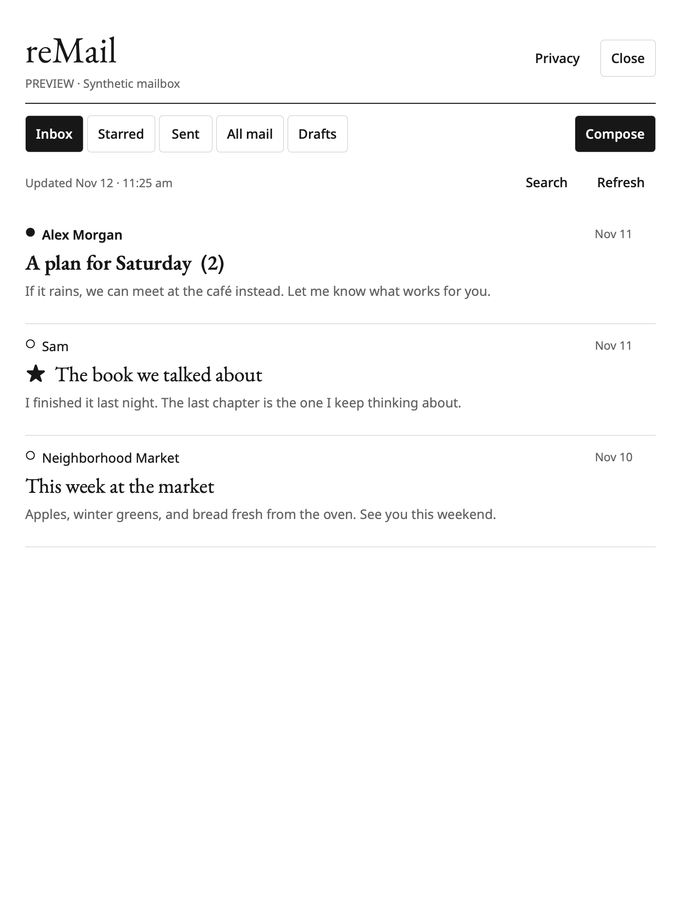

# reMail

Read and send mail directly from a reMarkable 2 using IMAP and SMTP. Setup runs on a Mac. Eligible Gmail accounts can use a Google app password.

**[Installation guide](INSTALL.md)** · **[Download IMAP preview](https://github.com/dared66/remarkable-tools/releases/tag/remail-v0.2.0-rc1)**



The IMAP preview lists individual messages. Inbox stars filters flagged inbox messages. Sent and Archive use configurable server folders. Search applies to the selected folder. Archive requires server support for IMAP MOVE. The reader shows a bounded text preview and attachment names. SMTP submits the message; whether a copy appears in Sent depends on the provider. Drafts and previously read mail are saved locally. Each send needs confirmation, and uncertain deliveries are never retried automatically.

The existing Gmail OAuth connection remains compatible for upgrades. The new protocol path has local TLS server tests; the ARM build also passed a synthetic AppLoad socket check on a physical reMarkable 2. Live provider testing is pending.

## Build from source

Installation uses the release download; this section is for development.
Install [Go 1.27+](https://go.dev/dl/) and Python 3.10+. From the repository root:

```sh
python3 -m venv .venv-build
.venv-build/bin/python -m pip install -r mail/requirements-build.txt
.venv-build/bin/python mail/scripts/build.py
.venv-build/bin/python mail/scripts/check_package.py
.venv-build/bin/python mail/scripts/preview.py
```

The build script finds Go and pyside6-rcc on PATH or in `.state/ui-preview-env`.
If using a virtual environment without activating it, set
`REMARKMAIL_RCC=.venv-build/bin/pyside6-rcc`. Run build.py with that environment's
Python so the icon renderer uses the same PySide6 installation. Overrides
`REMARKMAIL_GO`, `REMARKMAIL_RCC`, and `REMARKMAIL_PYTHON` are also supported.

Outputs are `downloads/RemarkMail-rm2.tar.gz`, the unpacked package at
`downloads/mail-package/RemarkMail/`, and `downloads/remarkmail-preview` for the
host. ARMv7 builds use `CGO_ENABLED=0`; no Go, Python, or Qt installation is added
to the tablet. Dependencies are pinned. The package contains no credentials or
mailbox data. `COPYING` and third-party notices accompany the binary.

The preview runs the real QML with the Go backend in **demo mode**, using only
synthetic messages. It never contacts Gmail, including its Send demonstration.
Screenshots and disposable state go under `.state/mail-preview/`.
For an interactive preview, add `--interactive`.

Backend and account-flow checks:

```sh
(cd mail && go test ./... && go vet ./...)
python3 -m unittest discover -s mail/tests
```

See `.github/workflows/ci.yml` for the same backend and account checks in CI.
The ARM backend's AppLoad sequenced-packet protocol was also exercised on the
real tablet. Live inbox and conversation reads were verified. Actual email
sending and native tablet keyboard editing have not been tested on hardware;
send confirmation and uncertain-delivery handling have synthetic tests.

## Development layout

- `ui/Mail.qml`: AppLoad frontend, including an in-app Privacy panel.
- `cmd/remarkmail`: Go entrypoint and AppLoad/stdio transports.
- `internal/mailapp`: Gmail, account-scoped storage, drafts, and delivery records.
- `scripts/account.py`: IMAP/SMTP account setup and SSH transfer, plus legacy OAuth support.
- `scripts/credential_store.py`: explicit macOS Keychain backend; no plaintext fallback.
- `cmd/devicecheck`: synthetic on-device protocol check; never contacts Gmail.

The app's internal ID/directory remains `RemarkMail`; the launcher name is reMail.
Ctrl/Cmd+S saves, Ctrl/Cmd+N starts a draft, F6 toggles the keyboard, and Escape
closes a modal or keyboard before going back. Back and Close wait for draft
persistence. The idle backend stays running after closing to avoid an AppLoad
0.6.0 unloading race. See [upstream issue 82](https://github.com/asivery/rm-appload/issues/82).

Legacy OAuth account credentials live at `/home/root/.remarkmail/credentials.json`; cache and
local drafts live in account-scoped directories under `/home/root/.remarkmail/accounts/`.
Tablet files have private permissions but are unencrypted by reMail. IMAP credentials use RAM-backed storage on the tablet and Keychain on the Mac. Never include these files in packages, logs, or bug reports.

GPL-3.0-or-later. Copyright 2026 Krupa Poobala-Chandran.
