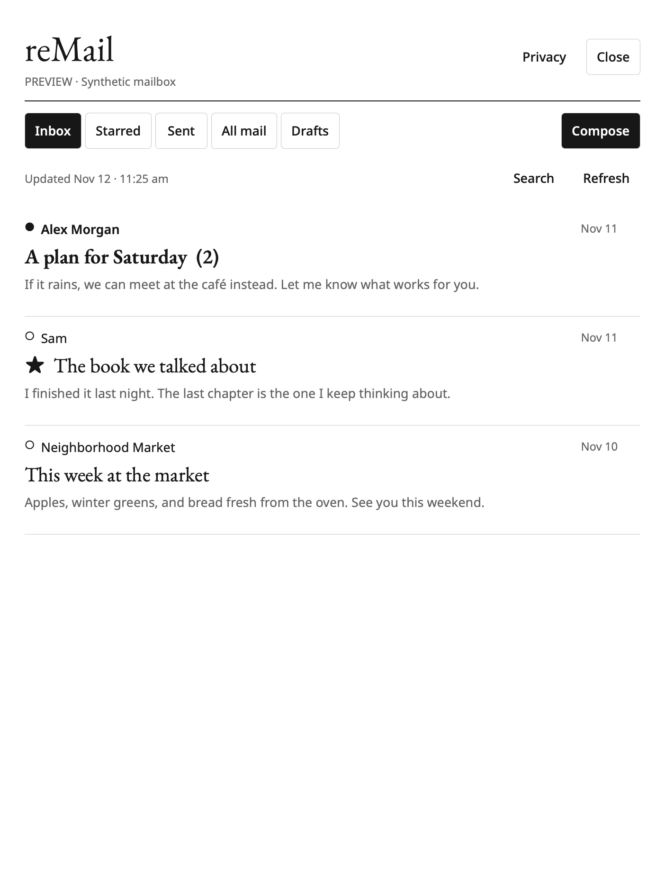

# reMail

Gmail on reMarkable 2: read conversations, compose and reply, keep local drafts,
and organize mail with a simple interface for the paper display.

**[Install reMail](INSTALL.md)** · **[Download v0.1.0](https://github.com/dared66/remarkable-tools/releases/tag/remail-v0.1.0)** · **[Website and privacy](https://krupapc.dev/apps/remail/)**



An experimental independent app, tested on reMarkable 2 / firmware 3.29.1.0 /
AppLoad 0.6.0 / XOVI 0.3.3. Other devices and firmware are unverified. No shared
Google OAuth service is included: connect a Desktop client from your own project.

## First version

- Inbox, Starred, Sent, and All mail, with Gmail search and pagination.
- Conversation reading, font-size controls, and attachment filenames.
- Compose and reply using physical or on-screen keyboards; optional Cc.
- Local drafts with autosave and save-before-navigation; drafts are scoped to
  the connected account. These are local drafts, not Gmail's Drafts folder.
- Archive, star/unstar, and mark read/unread after Gmail confirms the change.
- Cached mailboxes and previously opened conversations for offline reading.
- A recipient/subject confirmation before each send. No background sending.
- An in-app Privacy panel with storage disclosures and the full policy URL.
- Durable delivery records prevent automatic retries after a lost response or
  interrupted send. An uncertain delivery must be checked in Gmail's Sent folder.

Bodies are displayed as plain text. HTML is converted to text; no scripts,
remote images, or tracking images are loaded. Attachment downloads, rich HTML,
handwriting recognition, notifications, and Gmail draft synchronization are
outside this version. A conversation displays its latest 50 messages, with a
128 KiB text limit per message. Very large conversations show fewer recent
messages to fit AppLoad's transport, with a visible notice. List pages contain
up to 20 conversations. Oversized draft requests are rejected visibly while
the unsaved text remains in the editor.

## Build from source

Installation uses the release download; this section is for development.
Install [Go 1.27+](https://go.dev/dl/) and Python 3.10+. From the repository root:

```sh
python3 -m venv .venv-build
.venv-build/bin/python -m pip install -r mail/requirements-build.txt
.venv-build/bin/python mail/scripts/build.py
.venv-build/bin/python mail/scripts/check_package.py
.venv-build/bin/python mail/scripts/preview.py
```

The build script finds Go and pyside6-rcc on PATH or in `.state/ui-preview-env`.
If using a virtual environment without activating it, set
`REMARKMAIL_RCC=.venv-build/bin/pyside6-rcc`. Run build.py with that environment's
Python so the icon renderer uses the same PySide6 installation. Overrides
`REMARKMAIL_GO`, `REMARKMAIL_RCC`, and `REMARKMAIL_PYTHON` are also supported.

Outputs are `downloads/RemarkMail-rm2.tar.gz`, the unpacked package at
`downloads/mail-package/RemarkMail/`, and `downloads/remarkmail-preview` for the
host. ARMv7 builds use `CGO_ENABLED=0`; no Go, Python, or Qt installation is added
to the tablet. Dependencies are pinned. The package contains no credentials or
mailbox data. `COPYING` and third-party notices accompany the binary.

The preview runs the real QML with the Go backend in **demo mode**, using only
synthetic messages. It never contacts Gmail, including its Send demonstration.
Screenshots and disposable state go under `.state/mail-preview/`.
For an interactive preview, add `--interactive`.

Backend and account-flow checks:

```sh
(cd mail && go test ./... && go vet ./...)
python3 -m unittest discover -s mail/tests
```

See `.github/workflows/ci.yml` for the same backend and account checks in CI.
The ARM backend's AppLoad sequenced-packet protocol was also exercised on the
real tablet. Live inbox and conversation reads were verified. Actual email
sending and native tablet keyboard editing have not been tested on hardware;
send confirmation and uncertain-delivery handling have synthetic tests.

## Development layout

- `ui/Mail.qml`: AppLoad frontend, including an in-app Privacy panel.
- `cmd/remarkmail`: Go entrypoint and AppLoad/stdio transports.
- `internal/mailapp`: Gmail, account-scoped storage, drafts, and delivery records.
- `scripts/account.py`: PKCE browser sign-in and direct SSH account transfer.
- `scripts/credential_store.py`: explicit macOS Keychain backend; no plaintext fallback.
- `cmd/devicecheck`: synthetic on-device protocol check; never contacts Gmail.

The app's internal ID/directory remains `RemarkMail`; the launcher name is reMail.
Ctrl/Cmd+S saves, Ctrl/Cmd+N starts a draft, F6 toggles the keyboard, and Escape
closes a modal or keyboard before going back. Back and Close wait for draft
persistence. The idle backend stays running after closing to avoid an AppLoad
0.6.0 unloading race. See [upstream issue 82](https://github.com/asivery/rm-appload/issues/82).

Account credentials live at `/home/root/.remarkmail/credentials.json`; cache and
local drafts live in account-scoped directories under `/home/root/.remarkmail/accounts/`.
Tablet files have private permissions but are unencrypted by reMail. The Mac
copy uses Keychain. Never include these files in packages, logs, or bug reports.

GPL-3.0-or-later. Copyright 2026 Krupa Poobala-Chandran.
